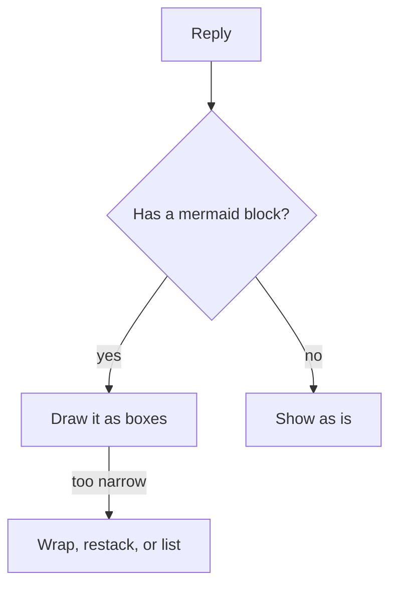
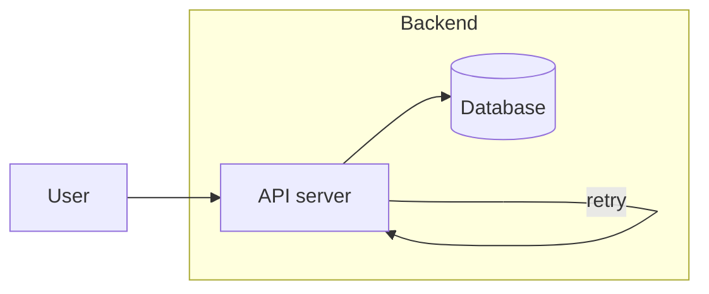
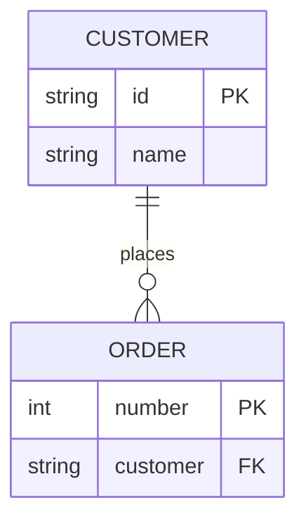

# mermaid-term

A [Claude Code](https://claude.com/claude-code) plugin that draws the mermaid diagrams in Claude's replies as box drawings, right in the terminal.

Markdown viewers such as Obsidian or GitHub turn a ```mermaid block into a picture, but a terminal shows only the source. mermaid-term rewrites how each reply is **displayed**: complete ```mermaid blocks are laid out and drawn with Unicode box characters, fitted to the width of your terminal window. The stored message is untouched, so copying the reply still gives you mermaid source.

## Install

At the prompt of a Claude Code terminal session:

```
/plugin install mermaid-term --marketplace JRay-Lin/mermaid-term
```

Answer `y` to add the marketplace, then pick a scope (user scope makes it work in every session).

From a shell:

```sh
claude plugin install mermaid-term --marketplace JRay-Lin/mermaid-term
```

No other setup: the renderer is plain TypeScript inside the plugin and needs no Node packages, Python or mermaid-cli.

## What it draws

| Diagram | Supported |
| --- | --- |
| `flowchart` / `graph` | all directions (`TD`, `TB`, `BT`, `LR`, `RL`); node shapes; solid, dotted (`-.->`) and thick (`==>`) links; link labels; `&` chains; `subgraph` frames, nested, with their own `direction`; links into and out of subgraphs; self loops |
| `sequenceDiagram` | participants and actors, all arrow types, notes, `loop` / `alt` / `opt` / `par` / `critical` / `break` blocks, `autonumber` |
| `erDiagram` | entities with attribute tables (type, name, `PK`/`FK`/`UK`, comment), cardinalities in symbol (`\|\|--o{`) and word (`only one to zero or more`) form, identifying and non-identifying (`..`) relationships, self relationships, `direction` |

Other diagram types (`classDiagram`, `stateDiagram`, `gantt`, `pie`, ...) are shown as their source, unchanged. A block that does not parse is shown as source too, with a one-line note saying why.

CJK text counts as two columns, so boxes stay aligned with Chinese, Japanese or Korean labels.

## Examples



```text
                   ┌───────┐
                   │ Reply │
                   └───┬───┘
                       │
                       ▼
           ╔══════════════════════╗
           ║ Has a mermaid block? ║
           ╚═══════════╤══════════╝
                       │
             ╭─────────┴─────────╮
            yes                 no
             ▼                   ▼
   ┌──────────────────┐   ┌────────────┐
   │ Draw it as boxes │   │ Show as is │
   └─────────┬────────┘   └────────────┘
             │
        too narrow
             ▼
┌────────────────────────┐
│ Wrap, restack, or list │
└────────────────────────┘
```



```text
           ┌┄┄┄┄┄┄┄┄┄┄┄┄┄┄┄┄┄┄┄┄┄┄┄┄┄┄┄┄┄┄┄┄┄┄┄┄┐
           ┆ Backend                            ┆
           ┆                                    ┆
┌──────┐   ┆   ┌─────────────┐   ╭──────────╮   ┆
│ User ├───┼──▶│ API server  ├──▶│ Database │   ┆
└──────┘   ┆   └─┬─────────┬─┘   ╰──────────╯   ┆
           ┆     ╰─ retry ─▲                    ┆
           ┆                                    ┆
           └┄┄┄┄┄┄┄┄┄┄┄┄┄┄┄┄┄┄┄┄┄┄┄┄┄┄┄┄┄┄┄┄┄┄┄┄┘
```



```text
  ┌──────────────────┐
  │     CUSTOMER     │
  ├──────────────────┤
  │ string  id    PK │
  │ string  name     │
  └─────────┬────────┘
            │1
         places
            │0..*
┌───────────┴──────────┐
│        ORDER         │
├──────────────────────┤
│ int     number    PK │
│ string  customer  FK │
└──────────────────────┘
```

## Narrow windows

The drawing is redone whenever the terminal is resized. When it does not fit, mermaid-term gives way step by step:

1. wrap the text inside boxes so they get narrower;
2. turn a left-to-right chart into a top-to-bottom one;
3. fall back to a list: boxes stacked top to bottom, with each branch written out (`├─ yes → Draw it as boxes`), subgraph names as headings;
4. below 24 columns, show the source with a note.

## Toggle

`/mermaid` switches between drawn diagrams and their mermaid source for the rest of the session.

## Limits

- `classDef`, `style`, `linkStyle` and `click` are ignored: the drawing has no colors.
- Only blocks that are complete are drawn; a block still being streamed shows as source until its closing fence arrives.
- Only the terminal is affected. The desktop app, VS Code and mobile keep their own rendering.

## Development

```sh
claude plugin validate .   # check the manifest and hooks module
claude plugin test .       # run hooks/register.test.tsx
claude --plugin-dir .      # start a session with the plugin loaded from this folder
```

- `hooks/mermaid.ts`: the parsers and the layout (layered layout, edge routing, width fitting). No imports, so it can also be run with plain `node`.
- `hooks/register.tsx`: the `ui.render` hook on `AssistantMessage` and the `/mermaid` command.

## License

MIT

---

## 中文說明

讓 Claude Code 在終端機裡把回覆中的 mermaid 區塊直接畫成框線圖。支援 flowchart（含 subgraph）、sequenceDiagram、erDiagram，中文字寬會正確對齊，並會隨視窗寬度自動重排；太窄時依序改為折行、改成由上往下、條列式。只改顯示，不改存下來的訊息。`/mermaid` 可切換圖與原始碼。
